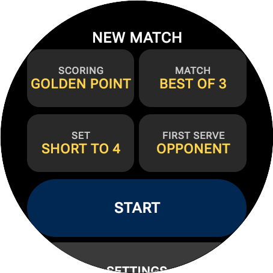
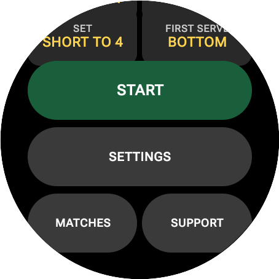
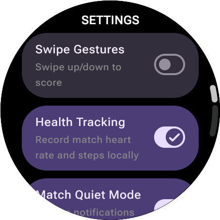
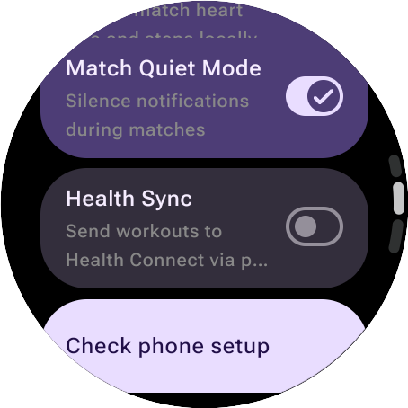

# 🎾 Padel Score for Wear OS

<!--suppress ALL -->

<p align="center">
  
</p>

<p align="center">
  <strong>A standalone, privacy-first Wear OS smartwatch app for keeping score during padel matches — 100% offline, fast, and effortless.</strong>
</p>

<p align="center">
  <a href="https://github.com/Hygros/PadelScore/releases"></a>
  <a href="https://developer.android.com/wear"></a>
  <a href="LICENSE"></a>
  <a href="#privacy"></a>
</p>

---

## 📱 Screenshots

<p align="center">
  
  &nbsp;&nbsp;
  
  &nbsp;&nbsp;
  
  &nbsp;&nbsp;
  
</p>

<p align="center">
  <sub><b>Match Setup</b> &nbsp;•&nbsp; <b>Live Scoring</b> &nbsp;•&nbsp; <b>Match Summary</b> &nbsp;•&nbsp; <b>Local History</b></sub>
</p>

---

## ✨ Features

- 🎾 **Official Padel Rules**: Advantage, Golden Point, and Star Point scoring modes.
- ⚙️ **Flexible Match Formats**: Single set, Best-of-3, Short sets (to 4 games), Normal sets (to 6 games), set tie-breaks, and match tie-breaks.
- 🟡 **Serve & Court Tracking**: Visual serve indicators (Deuce/Ad court) with 1-2-2 tie-break rotation and court change notifications.
- 🔕 **Match Quiet Mode**: Optional automatic Do Not Disturb mode during active matches to silence notifications and pop-ups.
- 🎯 **Court-Optimized UI**: Large touch targets, 300 ms double-tap safety lock, wrist haptics, and Always-On Display (AOD) support.
- ↺ **Instant Undo & Reset**: Quick point reversal and safety long-press match reset.
- 📜 **Local Match History**: Save and review past matches on your watch, including scores, durations, and total point breakdowns.
- 🔒 **100% Standalone & Privacy-First**: No phone app required, no internet permission requested, and zero tracking.

---

## 🚀 Installation

1. Download the latest APK from [GitHub Releases](https://github.com/Hygros/PadelScore/releases).
2. Install onto your Wear OS watch using **ADB over Wi-Fi** or a phone sideloading app (e.g. Bugjaeger, Easy Fire Tools):
   ```bash
   adb connect <WATCH_IP_ADDRESS>:5555
   adb install -r PadelScore.apk
   ```

---

<a id="privacy"></a>
## 🔒 Privacy & Permissions

- ❌ **No Internet Access**: `android.permission.INTERNET` is not requested.
- ❌ **No Tracking**: No telemetry, analytics, or background cloud sync.
- 💾 **100% Local**: All match state and history remain strictly on your watch.

---

## 📂 Project Structure

```text
app/src/main/java/ch/hygro/padelscore/
├── billing/        # Optional Supporter page Google Play Billing
├── logic/          # Core scoring engine & serve calculator
├── model/          # Match configuration and scoring data models
├── presentation/   # Wear OS Jetpack Compose UI & quiet mode controller
├── storage/        # Offline local match storage & persistence
└── vibration/      # Wrist haptic feedback engine
```

---

## 📄 License

This project is licensed under the [Apache License 2.0](LICENSE).
