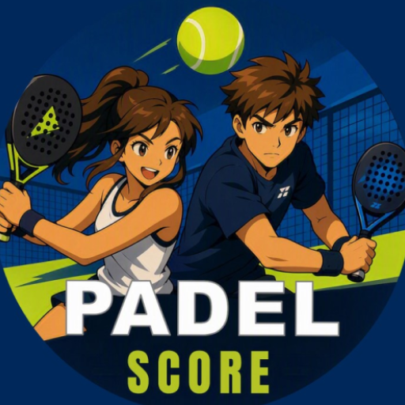
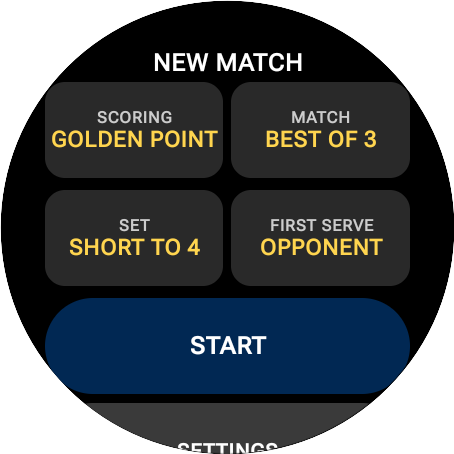
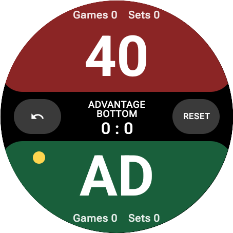
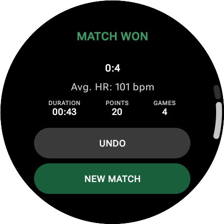
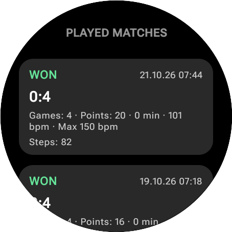
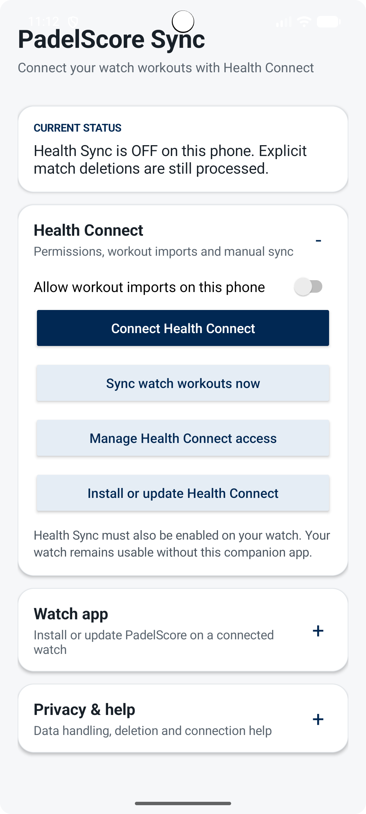
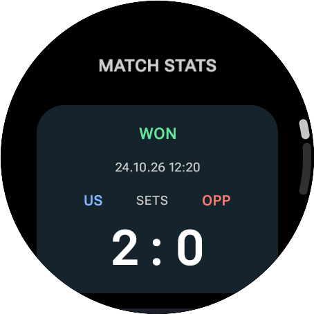
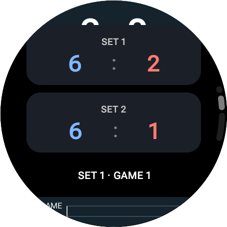
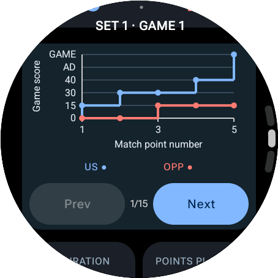
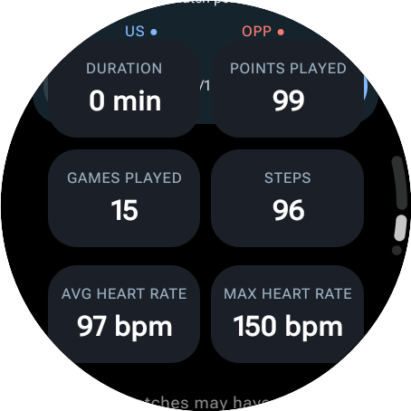

# 🎾 Padel Score for Wear OS

<!--suppress ALL -->

<p align="center">
  
</p>

<p align="center">
  <strong>A privacy-focused Wear OS padel scorekeeper with offline scoring, local match history and optional fitness tracking.</strong>
</p>

<p align="center">
  <a href="https://github.com/Hygros/PadelScore/releases"></a>
  <a href="https://developer.android.com/wear"></a>
  <a href="LICENSE"></a>
  <a href="#privacy"></a>
</p>

---

## 📱 Screenshots

<p align="center">
  
  &nbsp;&nbsp;
  
  &nbsp;&nbsp;
  
  &nbsp;&nbsp;
  
  &nbsp;&nbsp;
  
</p>

<p align="center">
  <sub><b>Match setup</b> &nbsp;•&nbsp; <b>Live scoring</b> &nbsp;•&nbsp; <b>Match summary</b> &nbsp;•&nbsp; <b>Local history</b> &nbsp;•&nbsp; <b>Optional companion</b></sub>
</p>

### 📊 Match statistics and point history

<p align="center">
  
  &nbsp;&nbsp;
  
  &nbsp;&nbsp;
  
  &nbsp;&nbsp;
  
</p>

<p align="center">
  <sub><b>Match breakdown</b> &nbsp;•&nbsp; <b>Point sequence</b> &nbsp;•&nbsp; <b>Game chart</b> &nbsp;•&nbsp; <b>Point-by-point history</b></sub>
</p>

---

## Support the project

If this project has been helpful to you, you can support its continued development:

[☕ Buy me a coffee](https://buymeacoffee.com/hygros)

Contributions, bug reports, and feature suggestions are equally appreciated.

---

## ✨ Features

### Scoring

- 🎾 **Padel scoring modes:** Classic Advantage, Golden Point and Star Point.
- ⚙️ **Flexible match formats:** One set, best of three, short sets, normal sets, set tie-breaks and match tie-breaks.
- 🟡 **Serve and court tracking:** Deuce and Advantage court indicators, service rotation and the 1-2-2 tie-break service sequence.
- ↩️ **Undo and reset:** Point reversal and protected long-press match reset.
- 💾 **Persistent matches:** Resume an in-progress match after leaving or restarting the app.
- 📜 **Local match history:** Review completed matches directly on the watch.
- 📊 **Detailed statistics:** Point history, match totals, game progression and set breakdowns.

### Wear OS experience

- ⌚ **Tiles and complications:** Start Padel Score from a Wear OS Tile or supported watch-face complication.
- 🔕 **Match Quiet Mode:** Optional integration with Android's notification-policy controls during an active match.
- 🎯 **Watch-oriented controls:** Large touch targets, haptic feedback and a short point-input lock to reduce accidental double taps.
- 🌙 **Always-on display support:** An ambient match display when Always-on Display is enabled on the watch.

### Optional fitness tracking

Fitness tracking is optional and requires the applicable Android and Wear OS permissions.

When enabled and supported by the watch, Padel Score can record:

- heart-rate samples;
- average heart rate;
- steps;
- active calories when provided by the device; and
- workout and match duration.

Fitness tracking uses AndroidX Health Services. Availability and measurements depend on the watch hardware, Wear OS version, permissions and other active workout applications.

Core scoring remains available when fitness tracking is disabled.

### Optional Android companion

The optional `PadelScore Sync` Android application can:

- receive completed workouts from the paired watch;
- write exercise sessions and heart-rate records to Android Health Connect;
- synchronise supported workout deletions;
- display synchronisation and permission status; and
- open the app's Play Store page on the paired watch.

Watch-to-phone transfer uses the Google Play services Wearable Data Layer. The companion app is not required for scoring or local match history.

### Optional supporter purchase

The Wear OS app may offer an optional one-time supporter purchase through Google Play Billing.

The purchase is optional and does not unlock or restrict the core scoring functions.

---

## 🚀 Installation

### GitHub APKs

1. Download the current APK files from [GitHub Releases](https://github.com/Hygros/PadelScore/releases).
2. Install the Wear OS APK on a compatible watch.
3. Optionally install the mobile companion APK on the paired Android phone if Health Connect synchronisation is required.

For development devices, installation can be performed with Android Debug Bridge:

```bash
adb devices
adb -s <WATCH_SERIAL> install -r PadelScore-Wear.apk
```

Do not publish device serial numbers, local IP addresses or wireless-debugging credentials.

The exact release asset names may include the application version and Android `versionCode`.

### Google Play closed test

Padel Score may also be available through a Google Play closed test:

1. Join the [Padel Score Testers group](https://groups.google.com/g/padel-score-testers).
2. Open the [Google Play testing invitation](https://play.google.com/apps/testing/ch.hygro.padelscore).
3. Install Padel Score through Google Play on a compatible Wear OS watch.

Access and availability are controlled by Google Play and may depend on the tester account, country, device compatibility and active testing track.

---

<a id="privacy"></a>

## 🔒 Privacy

Padel Score does not include:

- advertising;
- analytics;
- developer-operated telemetry;
- third-party crash reporting;
- user accounts; or
- developer-operated cloud storage.

Neither the Wear OS app nor the Android companion app requests the Android Internet permission.

### Local match data

Match state, point history, statistics and completed-match history are stored in the Wear OS app's private local storage.

### Optional health data

If fitness tracking is enabled, the Wear OS app processes health and fitness information locally. If Health Connect synchronisation is also enabled, completed workout information is transferred directly between the paired watch and phone and may be written to Health Connect.

No match or health information is uploaded to a server operated by the developer.

### Google platform services

Some optional functions depend on Google platform components:

- Google Play Billing for the supporter purchase;
- Google Play services Wearable APIs for watch-to-phone transfer;
- Google Play for installation and updates; and
- Health Connect for on-device health-record storage.

Those components may process information under Google's own terms and privacy policies.

See the full docs/privacy-policy.md for details about permissions, local storage, Health Connect, Billing, deletion and retention.

---

## 🧩 Project structure

```text
app/
└── src/main/
    ├── java/ch/hygro/padelscore/
    │   ├── billing/        # Optional Google Play supporter purchase
    │   ├── complications/  # Watch-face complication data source
    │   ├── health/         # Health Services recording and phone sync
    │   ├── logic/          # Scoring engine and serve calculator
    │   ├── minigame/       # Local Padel Pong minigame
    │   ├── model/          # Match configuration and state models
    │   ├── presentation/   # Wear OS Compose user interface
    │   ├── storage/        # Local match and workout storage
    │   ├── tiles/          # Wear OS Tile
    │   └── vibration/      # Haptic feedback
    └── res/

mobile/
└── src/main/
    ├── java/ch/hygro/padelscore/sync/
    │   └──               # Wearable transfer and Health Connect import
    └── res/
```

---

## 🛠️ Build requirements

The project currently uses:

- Android Gradle Plugin 9.4.1;
- Gradle 9.8.2 through the included Gradle Wrapper;
- Java 25 for the configured Gradle daemon toolchain;
- compile SDK 37;
- target SDK 37;
- minimum SDK 30 for the Wear OS module; and
- minimum SDK 28 for the Android companion module.

The source code targets Java 11 bytecode. The Java version used to run Gradle is a separate build-tool setting.

### Windows

```powershell
.\gradlew.bat `
    :app:testDebugUnitTest `
    :mobile:testDebugUnitTest `
    :app:lintRelease `
    :mobile:lintRelease `
    :app:assembleRelease `
    :mobile:assembleRelease `
    --stacktrace
```

### Linux or macOS

```bash
./gradlew \
  :app:testDebugUnitTest \
  :mobile:testDebugUnitTest \
  :app:lintRelease \
  :mobile:lintRelease \
  :app:assembleRelease \
  :mobile:assembleRelease \
  --stacktrace
```

Unsigned release APKs are expected under:

```text
app/build/outputs/apk/release/
mobile/build/outputs/apk/release/
```

Signing is configured only when all required `PADELSCORE_UPLOAD_*` environment variables are available. Keystores, passwords and tokens must never be committed.

---

## 🧪 Verification

Before publishing a release, verify:

```text
Wear unit tests
Mobile unit tests
Wear release lint
Mobile release lint
Wear release APK or bundle
Mobile release APK or bundle
R8 output
Merged manifests
APK permissions
Version name and version codes
Signing configuration
```

The project currently has separate default version codes for its two modules:

```text
Wear OS app: 12
Mobile app:  13
Version name: 1.3
```

Release workflows may override the version codes through Gradle properties.

---

## 📦 Distribution notes

The current Play-oriented build contains:

- Google Play Billing; and
- Google Play services Wearable APIs.

These dependencies are used only for the optional supporter purchase and watch-to-phone communication. Core scoring and local match history do not depend on a phone companion.

A future F-Droid build must exclude proprietary Google Play dependencies from the generated F-Droid APK. The current default release build should not be described as F-Droid-compatible until that separate build variant has been implemented and verified.

---

## 🤝 Contributing

Bug reports, feature proposals and code contributions are welcome.

See CONTRIBUTING.md before preparing a contribution.

When reporting a problem:

- do not publish health records;
- do not publish purchase tokens;
- do not publish device serial numbers;
- do not publish local IP addresses;
- do not publish signing information; and
- do not place credentials or private vulnerability details in a public issue.

Security issues should be handled according to SECURITY.md.

---

## 📄 Licence

Padel Score is licensed under the [Apache License 2.0](LICENSE).